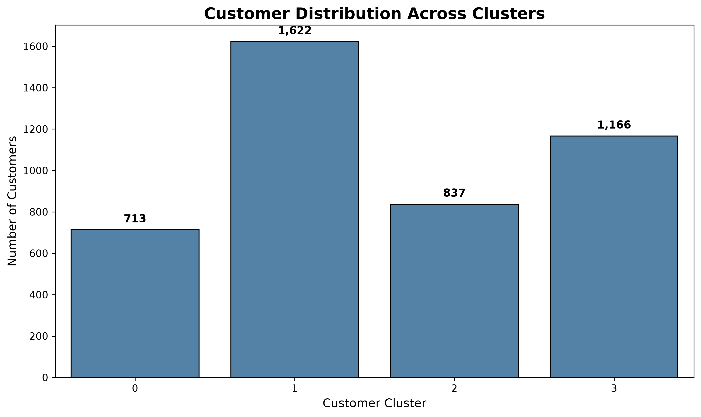
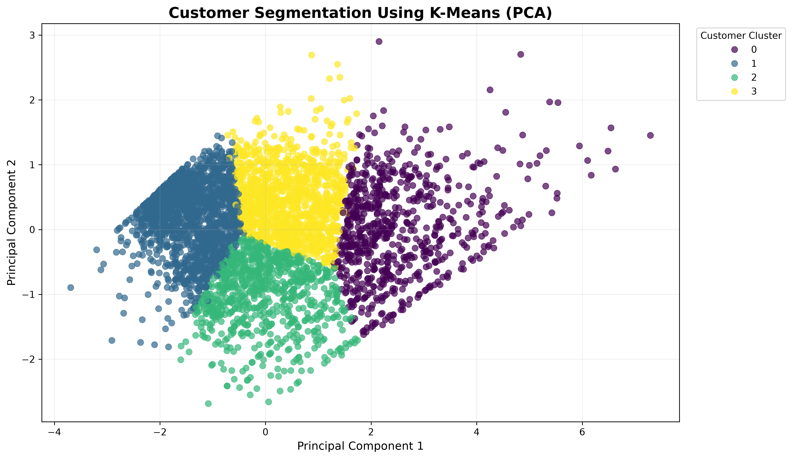
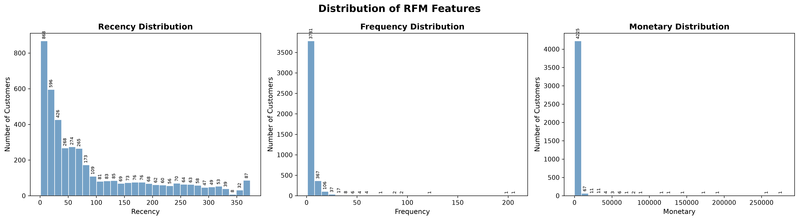

# Customer Segmentation Using K-Means Clustering

## Project Overview

This project applies **K-Means Clustering** to the UCI Online Retail dataset to identify distinct customer segments based on purchasing behavior.

Using **Recency, Frequency, and Monetary (RFM) analysis**, customers are grouped into meaningful segments that help businesses understand purchasing patterns, identify high-value customers, improve customer retention, and develop targeted marketing strategies.

## Project Objectives

- Perform data cleaning and preprocessing on retail transaction data.
- Conduct Exploratory Data Analysis (EDA) to understand customer purchasing behavior.
- Perform RFM feature engineering.
- Apply log transformation and feature scaling.
- Determine the optimal number of clusters using the Elbow Method and Silhouette Score.
- Implement K-Means clustering to segment customers.
- Evaluate clustering performance using clustering evaluation metrics.
- Visualize customer segments using Principal Component Analysis (PCA).
- Generate business insights and customer-specific marketing recommendations.

## Dataset Information

| Attribute | Description |
|---|---|
| Dataset | Online Retail |
| Source | UCI Machine Learning Repository |
| Original Records | 541,909 transactions |
| Cleaned Records | 392,692 transactions |
| Unique Customers | 4,338 |
| Countries | 37 |

**Dataset Source:** [UCI Online Retail Dataset](https://archive.ics.uci.edu/dataset/352/online+retail)

The cleaned dataset is excluded from this repository because of its large file size.

It is generated locally during data preprocessing and stored in `data/processed/`.

## Technologies Used

- **Programming Language:** Python
- **Data Analysis:** Pandas, NumPy
- **Data Visualization:** Matplotlib, Seaborn
- **Machine Learning:** Scikit-learn
- **Development Environment:** Jupyter Notebook

## Project Workflow

1. Dataset Understanding and Initial Inspection
2. Data Cleaning and Preprocessing
3. Exploratory Data Analysis (EDA)
4. RFM Feature Engineering
5. Feature Selection and Scaling
6. Optimal Number of Clusters
7. K-Means Clustering
8. Cluster Evaluation
9. Customer Segment Profiling
10. Cluster Visualization
11. Business Insights and Recommendations
12. Conclusion

## RFM Analysis

Customer segmentation was performed using three RFM features:

| Feature | Description |
|---|---|
| **Recency** | Number of days since the customer's last purchase |
| **Frequency** | Number of unique invoices associated with the customer |
| **Monetary** | Total spending by the customer |

Log transformation was applied to reduce feature skewness, followed by **StandardScaler** to normalize feature scales before clustering.

## Optimal Cluster Selection

The optimal number of clusters was determined by evaluating:

- Elbow Method
- Silhouette Score
- Cluster Size Comparison

Based on these evaluations, **K = 4** was selected for the final customer segmentation model.

## Model Evaluation

The final K-Means model achieved the following clustering evaluation results:

| Evaluation Metric | Score |
|---|---:|
| Silhouette Score | 0.3375 |
| Davies-Bouldin Index | 1.0086 |
| Calinski-Harabasz Score | 3328.34 |

These metrics were used to assess cluster separation, compactness, and overall clustering structure.

## Customer Segmentation Results

The final model identified four customer segments:

| Cluster | Customers | Percentage | Customer Segment |
|---|---:|---:|---|
| 0 | 713 | 16.44% | Champions |
| 1 | 1,622 | 37.39% | Inactive Customers |
| 2 | 837 | 19.29% | Recent Low-Frequency Customers |
| 3 | 1,166 | 26.88% | Loyal / High-Value Customers |
| **Total** | **4,338** | **100%** | |

## Visualizations

### Customer Segment Distribution



### PCA Cluster Visualization



### RFM Feature Distributions



## Segment Interpretation

- **Champions:** Customers with recent purchases, high purchase frequency, and high spending.
- **Inactive Customers:** Customers with long periods since their last purchase and low purchase frequency.
- **Recent Low-Frequency Customers:** Customers who purchased recently but have relatively low purchase frequency and spending.
- **Loyal / High-Value Customers:** Customers with comparatively higher purchase frequency and spending than low-frequency customers.

## PCA-Based Cluster Visualization

Principal Component Analysis (PCA) was used to reduce the three scaled RFM features into two dimensions for visualization.

| Principal Component | Variance Explained |
|---|---:|
| PC1 | 75.08% |
| PC2 | 18.79% |
| **Total** | **93.87%** |

The first two principal components explain **93.87% of the total variance**, allowing the customer segments to be visualized effectively in two dimensions.

PCA was used only for visualization. The K-Means model was trained on the scaled RFM features.

## Business Insights and Recommendations

| Customer Segment | Business Recommendation |
|---|---|
| Champions | Reward high-value customers through loyalty programs, exclusive offers, and premium services. |
| Inactive Customers | Launch re-engagement campaigns, personalized discounts, and targeted promotional emails. |
| Recent Low-Frequency Customers | Encourage repeat purchases through product recommendations, follow-up offers, and cross-selling. |
| Loyal / High-Value Customers | Strengthen customer loyalty through personalized rewards, retention campaigns, and upselling. |

## Project Structure

```text
customer-segmentation-using-k-means/
│
├── data/
│   ├── raw/
│   │   └── Online Retail.csv
│   │
│   └── processed/
│       ├── cleaned_online_retail.csv
│       ├── rfm_dataset.csv
│       ├── rfm_scaled.csv
│       └── rfm_dataset_with_clusters.csv
│
├── notebooks/
│   └── customer_segmentation.ipynb
│
├── models/
│   └── kmeans_model.pkl
│
├── visualizations/
│
├── README.md
├── requirements.txt
└── .gitignore
```

## How to Run the Project

### 1. Clone the Repository

```bash
git clone https://github.com/Anil-Vana/Customer-Segmentation-KMeans.git
cd Customer-Segmentation-KMeans
```

### 2. Create a Virtual Environment

```bash
python -m venv .venv
```

Activate the environment:

**Windows**

```bash
.venv\Scripts\activate
```

**Linux / macOS**

```bash
source .venv/bin/activate
```

### 3. Install Dependencies

```bash
pip install -r requirements.txt
```

### 4. Download the Dataset

Download the Online Retail dataset from the [UCI Machine Learning Repository](https://archive.ics.uci.edu/dataset/352/online+retail).

Place the dataset inside:

```text
data/raw/Online Retail.csv
```

### 5. Run the Notebook

```bash
jupyter notebook
```

Open:

```text
notebooks/customer_segmentation.ipynb
```

Execute the notebook cells sequentially to reproduce the analysis.

## Conclusion

This project demonstrates the application of unsupervised machine learning for customer segmentation using K-Means clustering and RFM analysis.

The analysis identified four customer segments with distinct purchasing behaviors and spending patterns. Cluster evaluation metrics and PCA-based visualization were used to assess the clustering results.

The resulting customer segments provide actionable insights for targeted marketing, customer retention, loyalty programs, and data-driven business decision-making.

Overall, this project highlights how **machine learning and customer analytics can support business strategy and customer relationship management**.
